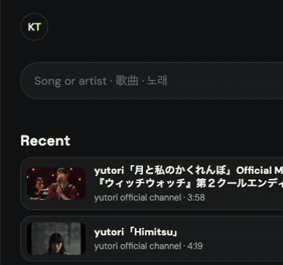
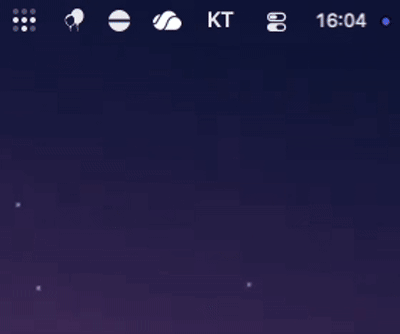

# KTVibes

An independently maintained fork of [KTVibes by Andrew Lee](https://github.com/andyleenz/KTVibes). This fork keeps the KTVibes name and MIT license. For features and instructions shared with the original project, see the [upstream README](https://github.com/andyleenz/KTVibes#readme).

### Japanese furigana alignment

Furigana stays aligned with its kanji as lyrics highlight during playback.


### Mobile lyrics

Open a dedicated lyrics viewer from the phone remote. Search LRCLIB with parsed title terms or your own query, preview results, and choose synced or plain lyrics. Mark a song as having no suitable lyrics when lookup finds no match.


### Remote queue management

See each queued song's lyrics status, change the song order, insert a song to play next, and remove songs from the queue.


### Wide-screen remote

On wide screens, the remote uses a two-column layout for song lists and playback controls.


### Multiplayer identities

Each person can choose an identity or create one with a name and avatar. The shared queue shows who requested each song, so everyone can see whose pick is coming up. These profiles identify song requests; they do not require separate accounts.



### Desktop controls

The macOS menu bar and Windows system tray provide Network Settings, Open Player, Show Logs, and Launch at Login. Network Settings can select a network interface and port, or configure external access.



### External access

Configure an external HTTPS address and PIN in Network Settings. Sign in on Player, then invite guests to Remote with the on-screen QR code or a shareable link. Guests using an invite do not need to enter the PIN. The invite key changes whenever the server restarts. When External address is disabled, local devices can open `/remote` directly.

## Installation

### Windows

Download and run [`KTVibes-Setup-x64.exe`](https://github.com/JeffShih-wiwynn/KTVibes/releases/latest). If SmartScreen appears, select **More info → Run anyway**.

### macOS

Download the Apple silicon DMG from the [latest KTVibes release](https://github.com/JeffShih-wiwynn/KTVibes/releases/latest), open it, and drag KTVibes to Applications. If macOS blocks the first launch, try opening it once, then go to **System Settings → Privacy & Security → Open Anyway** ([Apple's instructions](https://support.apple.com/en-euro/guide/mac-help/mh40617/27/mac/27)).

### Linux

Install the latest stable release:

```bash
curl -LsSf https://raw.githubusercontent.com/JeffShih-wiwynn/KTVibes/dev/install.sh | bash
```

To install another branch, replace `BRANCH_NAME` with the branch you want (for example, `dev`):

```bash
curl -LsSf https://raw.githubusercontent.com/JeffShih-wiwynn/KTVibes/dev/install.sh | bash -s -- --branch "BRANCH_NAME"
```

To update a Linux installation, run `ktvibes` and select **Version**. It follows the installed stable release or selected branch.

## Development

For Python and Remote browser test commands, see [Testing](docs/testing.md).
For module responsibilities and dependency boundaries, see [Code structure](docs/architecture.md).

## Upstream and license

This project is based on [andyleenz/KTVibes](https://github.com/andyleenz/KTVibes). The upstream MIT license and copyright notice are retained in [`LICENSE`](LICENSE). Changes in this fork are maintained independently.
